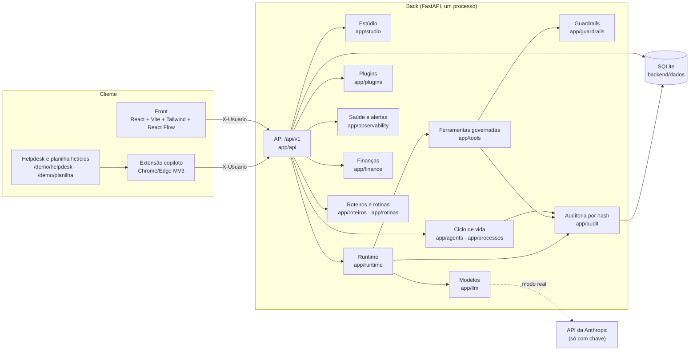
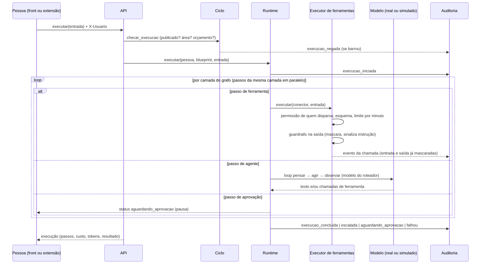

# StoneFalcon — Arquitetura

Como o StoneFalcon é montado hoje (v8). Para o que a plataforma precisa fazer, veja [REQUIREMENTS.md](REQUIREMENTS.md); para a linguagem visual, [DESIGN.md](DESIGN.md); para trabalhar no repositório, [AGENTS.md](AGENTS.md).

> Protótipo acadêmico (UFSC) para o desafio StoneLab. Não é um produto da Stone. Pessoas, áreas e dados são fictícios.

## 1. Visão geral

- **Um endereço só.** Depois de `npm run build`, o FastAPI serve o front compilado (`frontend/dist`) no mesmo endereço da API (`http://localhost:8765`). Em desenvolvimento, o Vite (porta 5173) repassa `/api`, `/demo` e `/avatares` ao back (`frontend/vite.config.ts`).
- **Um processo só.** A sequência da auditoria é protegida por uma trava em memória e os plugins integrados ficam num cache em memória. Por isso o back roda sem `--workers` (veja [seção 9](#9-do-protótipo-à-produção)).
- **O back é a fonte da verdade.** Quem a pessoa é, o que ela vê e o que ela pode executar é decidido no back. O front e a extensão só leem.

## 2. Back (`backend/app`)

Ponto de entrada: `main.py`. No início (`ciclo`), cria as tabelas, sincroniza os plugins gravados no banco e, se o banco está vazio, semeia a demonstração (`seed/demo.py`, desligável com `STONEFALCON_SEMEAR=0`). Duas tarefas em segundo plano reavaliam os alertas a cada minuto (`STONEFALCON_VIGIA=0` desliga) e disparam as rotinas vencidas a cada 5 segundos (`STONEFALCON_AGENDADOR=0` desliga).

| Pasta | Responsabilidade |
|---|---|
| `api/` | Rotas HTTP, uma por assunto (agentes, processos, execuções, estúdio, ferramentas, plugins, arquivos, finanças, saúde, balanceador, mapa, rotinas, roteiros, extensão, plataforma). Só orquestram; a regra mora nos módulos abaixo. |
| `core/` | `identidade.py` (personas, papéis, níveis, abas), `config.py` (ambiente), `db.py` (motor e sessão), `versao.py` (versão única), `relogio.py`. |
| `studio/` | Onboarding guiado: descrição em português → blueprint de agente (modelo ou galeria de padrões). |
| `agents/` | Blueprint do agente, risco e custo estimado, ciclo de vida, versões e diff, governança. |
| `processos/` | Processos de blocos: blueprint, validação, compilação para o runtime, ciclo de vida, conversão de agentes antigos de vários passos. |
| `runtime/` | Motor de execução: camadas do grafo, loop do agente, aprovação humana, retomada, limites, escalada. |
| `llm/` | Cliente (real ou simulado), registro de modelos e preços, roteador, balanceador. |
| `tools/` | Catálogo de ferramentas, permissões, executor governado, sistemas fictícios. |
| `plugins/` | Marketplace: definições, integração e pedidos, **Arquivos e Planilhas (real)**, plugins internos criados pelos pedidos. |
| `guardrails/` | Mascaramento de dados pessoais e detecção de instrução embutida. |
| `audit/` | Trilha de auditoria encadeada por hash. |
| `observability/` | Métricas, nota de saúde, regras de alerta. |
| `finance/` | Premissas, resumo, ROI, calculadora (VPL, TIR, payback). |
| `roteiros/` | Roteiros guiados por persona, valor medido (AS IS × TO BE), Perguntas da Ferramenta, reinício. |
| `rotinas/` | Tarefas agendadas de agentes e processos. |
| `seed/` | Estado inicial da demo, arquivos e histórico sintético. |
| `static/` | Fotos das personas (`/avatares`), helpdesk e planilha fictícios. |

### Agente × processo

- **Agente** é um trabalhador: uma única tarefa de IA (ler e raciocinar), reutilizável, com versões e revisão. Um agente novo com mais de um passo é recusado (HTTP 422); agentes antigos de vários passos ainda rodam, em leitura, e podem ser convertidos em processo.
- **Processo** é o fluxo de blocos montado no canvas: `dados`, `agente`, `plugin`, `aprovacao`, `condicao` e `saida`, com dono, versões imutáveis e as mesmas regras de ciclo de vida.
- Os dois passam pela **mesma máquina de ciclo de vida** (`agents/ciclo.py`, classe `Ciclo` parametrizada pelo tipo do dono) e pelo **mesmo runtime**. `processos/compilar.py` traduz os blocos para o grafo de passos que o motor já executa.

### Ciclo de vida

Rascunho → revisão → publicado ⇄ pausado → depreciado. A versão publicada é imutável (editar gera outra em rascunho). Toda versão de risco alto passa pela revisão da Segurança, feita por alguém que não é o autor (quatro olhos). Segurança e CoE podem pausar qualquer agente ou processo na hora; o que foi depreciado não executa mais. Cada transição vai para a auditoria.

## 3. Fluxo de uma execução

Do gatilho à auditoria, para um processo publicado (`POST /api/v1/processos/{id}/executar`):

1. **Pré-checagem** (`Ciclo.checar_execucao`): o dono precisa estar publicado, a área da pessoa precisa ter acesso e o orçamento mensal não pode estar estourado. Se barrar, grava `execucao_negada`.
2. **Compilação** (só processo): os blocos viram passos; o agente de cada bloco é resolvido na hora. Se um agente está pausado, depreciado ou sem acesso, o passo nasce bloqueado e o runtime escala com o motivo.
3. **Motor** (`runtime/motor.py`): roda as camadas do grafo em sequência e os passos de uma camada em paralelo. Trava de orçamento por execução (custo e chamadas de modelo), limite de iterações por passo, ferramenta fora das permitidas é recusada. Qualquer falha que o agente não contorna vira **escalada** para um humano, com o motivo registrado.
4. **Passo de ferramenta** (`tools/executor.py`, o único caminho de um agente até um sistema), em ordem fixa: conector existe e está ativo → permissão de **quem disparou** (área e nível) → validação do esquema → limite de chamadas por minuto → falha injetada (demo) → execução → guardrails na saída → auditoria.
5. **Passo de agente**: o roteador escolhe o modelo mais barato que dá conta; o balanceador explica a escolha (“como o agente decidiu”). Dados pessoais chegam ao modelo como marcadores (`[CPF_1]`) e o valor real volta só na tela de quem perguntou.
6. **Aprovação humana**: ação sensível pausa a execução (`aguardando_aprovacao`). `runtime/motor.retomar` continua depois da decisão (`POST /execucoes/{id}/decisao`), registrando `aprovacao_concedida` ou `aprovacao_recusada`.
7. **Fechamento**: grava o resultado na tabela `execucao` (passos, tokens, custo, custo “tudo no modelo forte”, duração) e um evento final na auditoria. Em seguida a API reavalia os alertas.

Rotinas (`rotinas/`) usam o mesmo caminho: o agendador chama a execução em nome de quem agendou, com as mesmas permissões, guardrails e orçamento.

## 4. Acesso por perfil

Há dois eixos separados em `core/identidade.py`:

- **Papéis** dizem o que a pessoa pode *fazer* (`criador`, `curador`, `revisor_seguranca`, `engenharia`, `gestor_ia`, `ai_analyst`, `consulta_colaboradores`; todos têm `usuario`).
- **Nível de acesso** diz até que classificação de *dado* a pessoa toca (`publica < interna < confidencial < restrita`). Uma ferramenta só roda se o nível de quem *disparou* cobre a classificação dela, e a área da pessoa está entre as áreas do conector.

**Onde se decide:** o dicionário `ABAS` em `core/identidade.py` mapeia cada aba aos papéis que a veem (`None` = todos). `abas_permitidas(pessoa)` o lê e vai em `GET /api/v1/eu` e `GET /api/v1/perfis` (campo `abas`). A API usa `exigir_aba` e `exigir` nos mesmos pontos e responde 403.

**Como o front só lê:** `App.tsx` monta o menu (`NAV`) filtrando por `pessoa.abas`; `Guarda` devolve ao Início quem digita um endereço sem a aba. Nada no front calcula permissão. A extensão também não: lista só os agentes e processos que a API diz que a pessoa pode executar.

**Login simulado:** o front guarda o id da persona em `localStorage` e o envia no cabeçalho `X-Usuario` (`frontend/src/api/cliente.ts`). Em produção, entra o token do SSO.

## 5. Front (`frontend/src`)

- **Pilha:** React 18, React Router 6, TanStack Query, React Flow (canvas dos processos e Mapa de IA), Tailwind 3, Vite 6, TypeScript. Sem testes automatizados: a checagem é `npm run build` (tipos + compilação) e verificação no navegador.
- **Rotas** (em `App.tsx`): sem perfil, mostra `pages/Entrar.tsx` (a roda de personas); com perfil, o menu lateral e as páginas em `pages/` (uma por arquivo). Entrar sempre abre o Início (`/`) da persona.
- **Telas especiais:** `/extensao` é a moldura do painel da extensão (tema escuro, entra com `?perfil=`, só dentro de moldura); `/via-extensao` recebe o passe de uso único para abrir o Estúdio vindo da extensão.
- **Roteiros guiados** (`roteiro/`): `estado.ts` guarda o roteiro em andamento no `localStorage`; `Controle.tsx` (`ProvedorRoteiro`, `BarraRoteiro`) troca de perfil e navega para a tela de cada passo. O conteúdo dos roteiros vem do back (`roteiros/catalogo.py`).
- **Componentes** em `components/`: `RodaPersonas`, `Avatar`, `CanvasProcesso`, `PaletaBlocos`, `Graficos`, `Plugin`, `ArquivosPlugin` e afins.

## 6. Extensão copiloto (`extensao/`)

Manifest V3 (`manifest.json`), com `fundo.js` (service worker, menu de contexto), `botao.js` (botão flutuante sobre texto selecionado), `painel.html/js/css` (painel lateral) e `opcoes.html/js` (boas-vindas e teste de conexão). **Não tem lógica de IA nem chave:** envia o trecho selecionado a `POST /api/v1/extensao/analisar` (`api/extensao.py`), que sugere processos e agentes pela semelhança e preenche campos detectados; quem executa é a plataforma, com as permissões de quem está logado. “Criar Agente de IA” abre o Estúdio por um passe de uso único (60 s, vale uma vez). O helpdesk fictício (`/demo/helpdesk`) abre o mesmo painel dentro da página, para ensaiar sem instalar a extensão.

## 7. Modo simulado × modelos reais

`core/config.modo_real()` é verdadeiro só com `ANTHROPIC_API_KEY` e sem `MODO_SIMULADO=1`. Sem chave, tudo roda **sem custo e sem internet**.

| | Modo simulado | Modelos reais |
|---|---|---|
| Runtime, permissões, guardrails, auditoria, alertas, custos, ciclo de vida | **reais** (mesmo código) | reais |
| Texto produzido pelos modelos | **exemplo**, determinístico (`runtime/simulacao.py`, `runtime/respostas.py`) | gerado pelo Claude (`llm/cliente.py`, SDK `anthropic`) |
| Tokens e custos | **estimados** com a mesma régua | medidos da resposta |
| Provedores Gemini, GPT, DeepSeek, Grok | simulados | **continuam simulados** (só o Claude roda de verdade) |
| Sistemas externos dos plugins | fictícios | fictícios |
| Plugin Arquivos e Planilhas | **real** (envio, leitura e escrita de CSV e Excel) | real |
| Histórico de execuções | gerado pelo app (marcado `demo`) | idem; execuções novas são reais |

Se o modelo falha no modo real (rede, limite, chave), `STONEFALCON_RESERVA` (padrão ligado) usa a resposta pré-determinada em vez de escalar. O selo “Modo simulado” / “Modelos reais” fica no topo de toda tela.

## 8. Dados, auditoria, alertas e custos

- **Banco:** SQLite em `backend/dados/stonefalcon.db` (variável `STONEFALCON_DB`; em produção, só muda a URL para Postgres). Tabelas: `agente`, `agente_versao`, `processo`, `processo_versao`, `execucao`, `auditoria`, `alerta`, `rotina`, `rotina_execucao`, `conector_estado`, `plugin_integracao`, `plugin_pedido`, `plugin_interno_pedido`, `plugin_arquivo`. Colunas novas entram por `core/db.acrescentar_colunas`, sem apagar dados de versões anteriores.
- **Auditoria** (`audit/trilha.py`): cada evento guarda o hash SHA-256 do anterior. Alterar ou apagar uma linha quebra a cadeia e `verificar` aponta onde. Os dados entram já mascarados. Cobre criação, modificação, revisão, execução, escalada, aprovação, plugins, rotinas, alertas e depreciação.
- **Alertas** (`observability/alertas.py`): regras da plataforma, sem configuração do criador: agente falhando, agente lento, conector fora, conector lento, orçamento (80% atenção, 100% corte) e provedor fora. Abrem uma vez, avisam o responsável e fecham sozinhas.
- **Custos** (`finance/`, `llm/precos.py`): custo por execução, agente, processo, área, provedor e modelo; economia do roteador (custo real × “tudo no modelo forte”); orçamento mensal com corte; calculadora de investimento. Preços e dólar vêm de `llm/registro.py` e `core/config.py`, com fonte e data.
- **Reinício da demonstração** (`roteiros/reinicio.py`): volta ao estado inicial, geral ou o de um roteiro. Apaga o banco, inclusive a auditoria; só fica aberto a qualquer perfil enquanto `STONEFALCON_DEMO` não for `0`.

## 9. Scripts, testes e CI

- **Início:** `iniciar.bat` (Windows) e `iniciar.sh` (Mac/Linux) checam Python e porta, compilam o front quando a versão ou o código mudou, criam o `.venv` do back, reinstalam dependências quando o `requirements.txt` mudou e sobem o `uvicorn` (porta padrão 8765). Ajudantes em `scripts/iniciar_ajuda.py`.
- **Testes do back:** `pytest` em `backend/tests`, em modo simulado, com banco temporário (`conftest.py`); sem chave nem internet.
- **CI** (`.github/workflows/ci.yml`): `back` (pytest, Python 3.11 e 3.14), `front` (`npm run build`), `extensao` (`scripts/verifica_extensao.py`), `versao` (`scripts/verifica_versao.py`; fonte em `backend/app/core/versao.py`) e `iniciar` (`scripts/fumaca_iniciar.py` no Ubuntu e no Windows).

### Do protótipo à produção

| No protótipo | Em produção |
|---|---|
| Login simulado por personas | SSO (grupos → papéis e nível) |
| Sistemas internos fictícios | Conectores reais (APIs ou webhooks), mesmo contrato |
| Guardrails por expressões regulares | Serviço de prevenção a vazamento (DLP) e classificador de injeção |
| SQLite, um processo | Postgres; sequência da trilha por trava no banco, para vários processos |
| Trilha por hash no próprio banco | Hashes diários publicados em cofre externo (WORM) |
| Alertas no sino da plataforma | Também e-mail, Slack e plantão |
