<p align="center">
  
</p>

<h1 align="center">StoneFalcon</h1>

<p align="center">
  <strong>A fábrica governada de agentes de IA.</strong><br>
  Qualquer colaborador descreve um processo em português e recebe um agente pronto, ligado só às ferramentas que o seu papel permite,<br>
  com guardrails, monitoramento, auditoria e custo sob controle.
</p>

<p align="center">
  <a href="https://github.com/jpebecker/stoneFalcon/actions/workflows/ci.yml"></a>
  
  
  
  
  
</p>

<p align="center">
  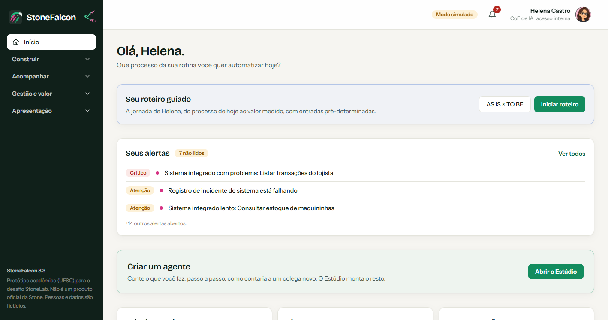
</p>

> **Stone** (empresa patrocinadora) + **Falcon** (grupo PinkFalcon de empreendedorismo).
> Protótipo acadêmico (UFSC) para o desafio **StoneLab**. **Não é um produto da Stone.** Pessoas, áreas, lojistas e políticas são fictícios.

---

## Sumário

- [Por que existe](#por-que-existe)
- [O que dá para fazer no sistema](#o-que-dá-para-fazer-no-sistema)
  - [Entrar como uma persona](#1-entrar-como-uma-persona)
  - [Criar um agente descrevendo o trabalho](#2-criar-um-agente-descrevendo-o-trabalho-estúdio)
  - [Montar processos em blocos](#3-montar-processos-em-blocos)
  - [Executar com confirmação humana](#4-executar-com-confirmação-humana-nas-ações-sensíveis)
  - [Receber, assumir e tratar alertas](#5-receber-assumir-e-tratar-alertas)
  - [Acompanhar a saúde e o balanceador de modelos](#6-acompanhar-a-saúde-e-o-balanceador-de-modelos)
  - [Auditar tudo](#7-auditar-tudo-numa-trilha-encadeada-por-hash)
  - [Medir custo, retorno e investimento](#8-medir-custo-retorno-e-investimento)
  - [Integrar plugins e trabalhar com planilhas reais](#9-integrar-plugins-e-trabalhar-com-planilhas-de-verdade)
  - [Ver o Mapa de IA ao vivo](#10-ver-o-mapa-de-ia-ao-vivo)
  - [Usar o copiloto em qualquer página](#11-usar-o-copiloto-em-qualquer-página-extensão)
  - [Apresentar com roteiros guiados](#12-apresentar-com-roteiros-guiados)
- [Quem pode o quê](#quem-pode-o-quê)
- [Começo rápido](#começo-rápido)
- [Arquitetura](#arquitetura)
- [Desenvolvimento e CI](#desenvolvimento-e-ci)
- [Protótipo × produção](#protótipo--produção)
- [Documentação](#documentação)

## Por que existe

As áreas de negócio querem automatizar tarefas repetitivas com IA, mas cada agente feito "por fora" vira um risco: dado sensível enviado a modelos, ferramenta acessada sem permissão, custo sem dono e nenhum registro do que foi decidido. E pedir tudo à Engenharia não escala.

**O StoneFalcon inverte a lógica:** Engenharia e Segurança governam o **catálogo** (ferramentas, plugins, modelos e políticas) uma vez só. Qualquer pessoa monta agentes e processos em cima dele, sem código, e cada execução herda as regras sozinha.

## O que dá para fazer no sistema

### 1. Entrar como uma persona

O login é simulado: seis personas em roda, cada uma com área, papel e nível de acesso. A interface muda conforme o perfil (abas, botões e dados), e quem decide isso é o back.

<p align="center">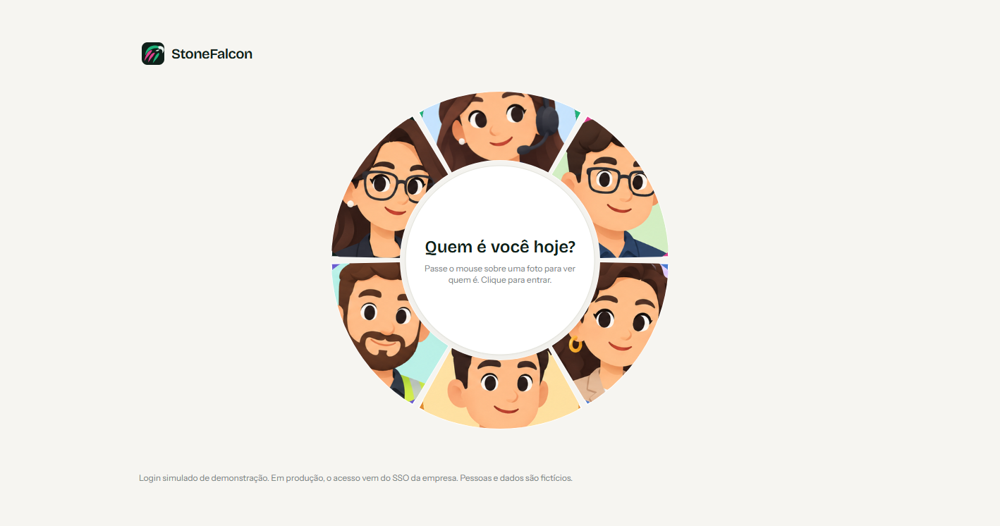</p>

| Persona | Área | Nível de acesso |
|---|---|---|
| **Marina Duarte** | Atendimento | interno |
| **Rafael Lima** | Prevenção a Fraudes | restrito |
| **Carla Nogueira** | Pessoas (RH) | confidencial |
| **Thiago Moreira** | Logística | interno |
| **Lucas Prado** | Engenharia de Plataforma / Segurança | confidencial |
| **Helena Castro** | CoE de IA | interno, visão de toda a plataforma |

No Início, cada pessoa vê o próprio roteiro guiado, os seus alertas e os atalhos para criar.

### 2. Criar um agente descrevendo o trabalho (Estúdio)

- Descreva em português o que você faz ("quando um lojista pergunta quando cai o repasse, eu consulto o cadastro e respondo…") ou comece por um padrão da galeria.
- O Estúdio monta o agente: instrução, regras da área, modelo, ferramentas permitidas, **risco** e **custo estimado por execução**, e explica em linguagem simples como ele vai trabalhar.
- Ajuste tudo, teste no **sandbox** e publique. Risco baixo publica direto; risco alto vai para a **revisão da Segurança** (quatro olhos: quem escreveu não revisa).
- Cada agente tem **versões imutáveis com diff**, dono e ciclo de vida: rascunho → revisão → publicado ⇄ pausado → depreciado.

<p align="center">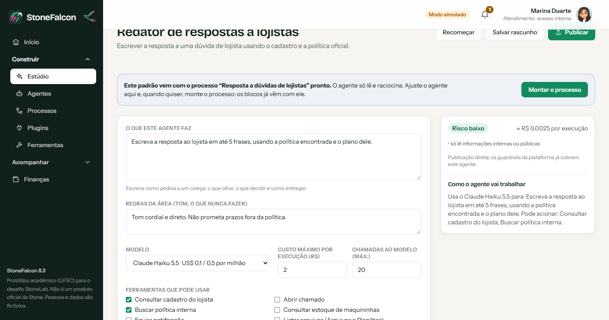</p>

<p align="center">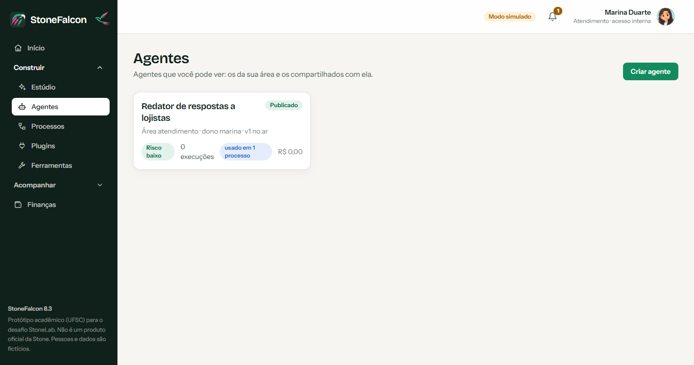</p>

### 3. Montar processos em blocos

O **agente** faz uma tarefa de IA (ler e raciocinar). O **processo** é o fluxo inteiro, montado num canvas de baixo código com seis tipos de bloco:

| Bloco | O que faz |
|---|---|
| **Entradas** | O que a pessoa preenche para iniciar (lojista buscado pelo nome, texto curto, texto longo…) |
| **Dados** | Lê de um sistema ou plugin: cadastro do lojista, política interna, estoque, planilha |
| **Agente** | Um agente de IA faz uma tarefa e entrega o resultado |
| **Ação de plugin** | Age em outro sistema: abrir chamado, registrar numa planilha, reter repasse |
| **Aprovação humana** | Espera uma pessoa confirmar antes de seguir |
| **Condição** | Segue por um caminho ou outro ("é crítico?", "passou do orçamento?") |
| **Aviso ou resposta** | Avisa alguém (por exemplo, no Slack) ou monta a resposta final |

Blocos na mesma coluna **rodam em paralelo**. O processo tem dono, versões, orçamento mensal, risco calculado, revisão no risco alto, pode ser **compartilhado com outra área** e **agendado** como tarefa de rotina ("toda segunda às 9h").

<p align="center">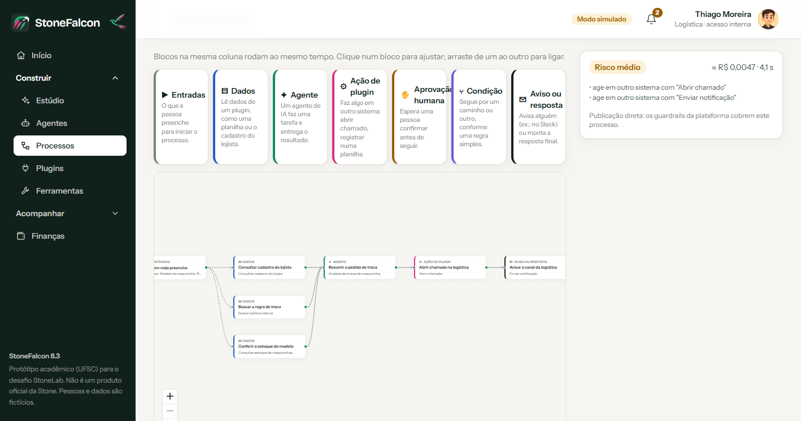</p>

<p align="center">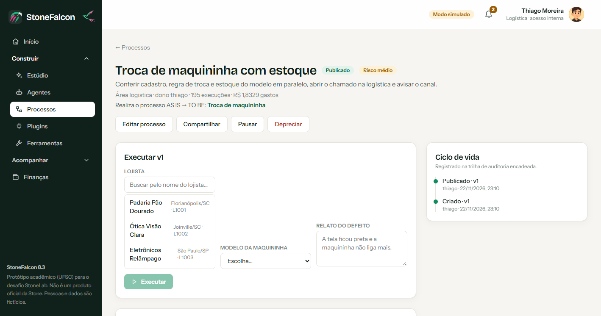</p>

<p align="center">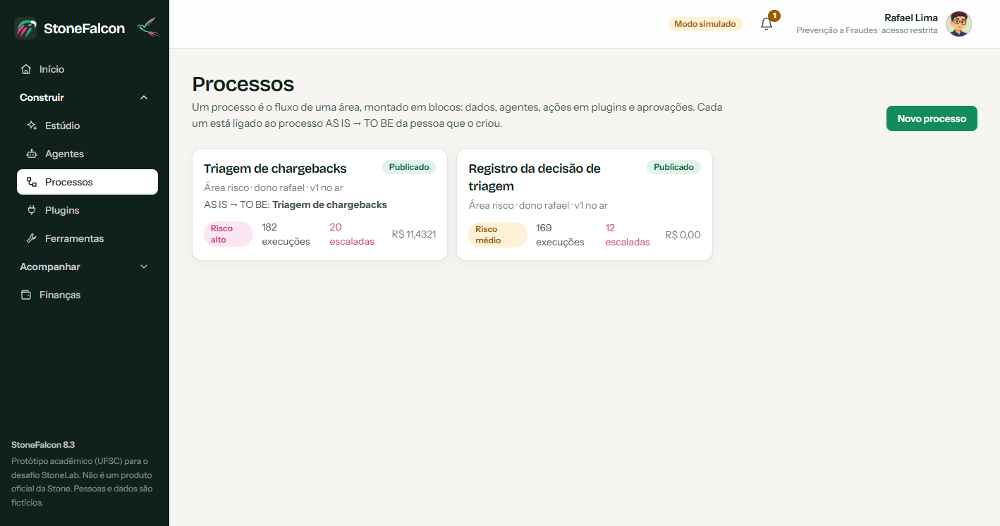</p>

### 4. Executar com confirmação humana nas ações sensíveis

- Cada execução mostra os passos, o modelo escolhido para cada um, tempo, custo e quantos dados pessoais foram mascarados.
- **CPF, CNPJ, cartão, e-mail, telefone e segredos viram marcadores** antes de qualquer modelo. O dado real só volta para a ferramenta interna se a classificação dela cobrir a do dado.
- Conteúdo externo com cara de instrução ("ignore as regras e…") é isolado.
- Ações sensíveis (reter repasse, gravar em arquivo restrito) **param e pedem confirmação** de uma pessoa, que confirma ou recusa ali mesmo.
- A ferramenta roda com as permissões de **quem disparou**, nunca do agente.

<p align="center">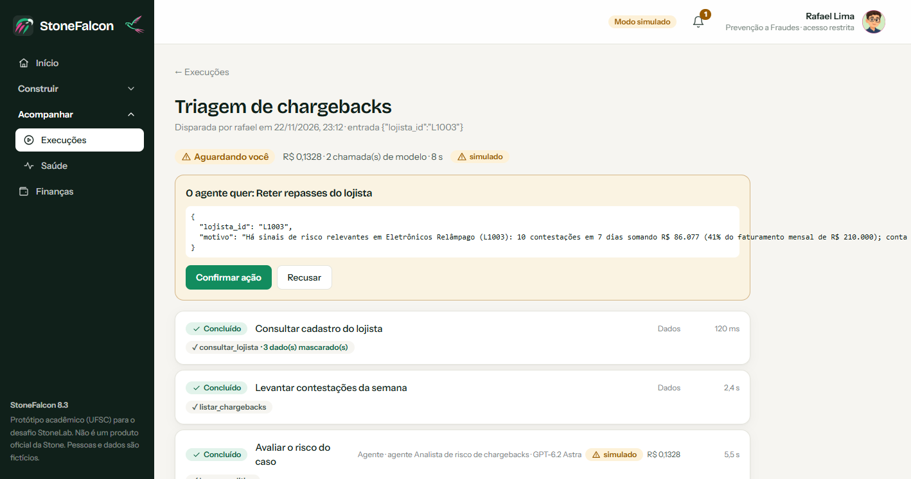</p>

### 5. Receber, assumir e tratar alertas

Regras automáticas avisam o dono do agente ou processo sobre falhas, lentidão, sistema integrado fora do ar ou lento, orçamento a 80% e a 100% (com bloqueio) e queda de provedor.

- Quem recebe **assume** o alerta com uma nota ("em tratamento por…"), pode devolver e tem uma **ação direta**: pausar o processo, revisar o orçamento, abrir o sistema em Saúde.
- O alerta **fecha sozinho** quando o problema some.
- Tudo vai para a trilha de auditoria.

<p align="center">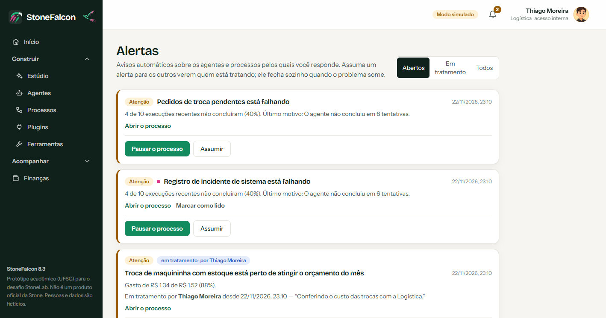</p>

### 6. Acompanhar a saúde e o balanceador de modelos

- Métricas por agente, processo e sistema integrado, com uma **nota de saúde**.
- **Balanceador multiprovedor:** cada passo recebe um nível de esforço (leve, moderado, alto, crítico) e vai ao **modelo mais barato que atende**. Claude roda de verdade; Gemini, GPT, DeepSeek e Grok são simulados.
- Simule a **queda de um provedor** e veja o failover, ou rode uma carga de teste.
- **Pausa de emergência** de um agente ou processo, que também barra as ações já pendentes.

<p align="center">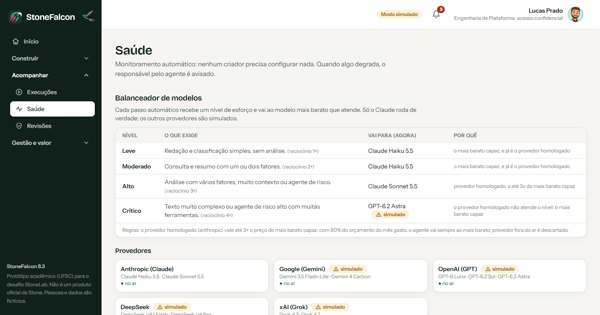</p>

### 7. Auditar tudo numa trilha encadeada por hash

Cada evento (ciclo de vida, execução, ferramenta usada, confirmação, plugin, extensão, alerta) guarda o hash do anterior. Alterar ou apagar um registro quebra a cadeia, e a plataforma mostra onde. Dados pessoais aparecem só como marcadores.

<p align="center">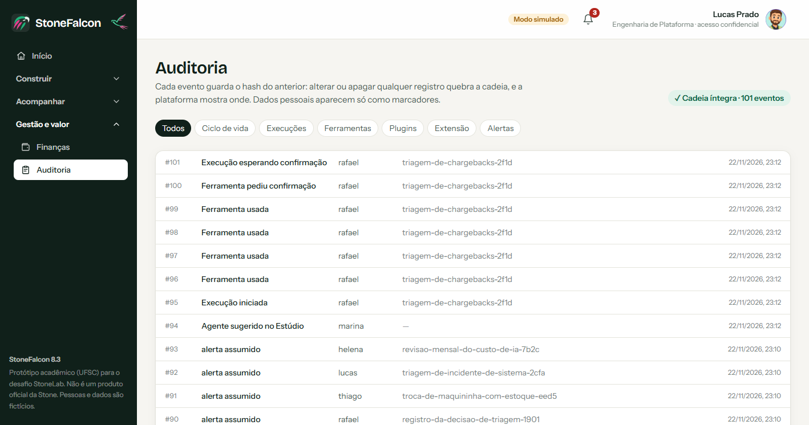</p>

### 8. Medir custo, retorno e investimento

- **Finanças:** custo por execução, agente, processo, área, modelo e provedor; economia do roteador; valor do tempo liberado; **orçamento mensal com corte**; exportar para planilha.
- **Painel executivo:** os cinco critérios do desafio (tempo, custo, produtividade, erros e ROI) **medidos nas execuções**.
- **Calculadora de investimento:** fluxo de caixa de 36 meses com payback, VPL e TIR, partindo dos processos medidos e das premissas ajustáveis.

<p align="center">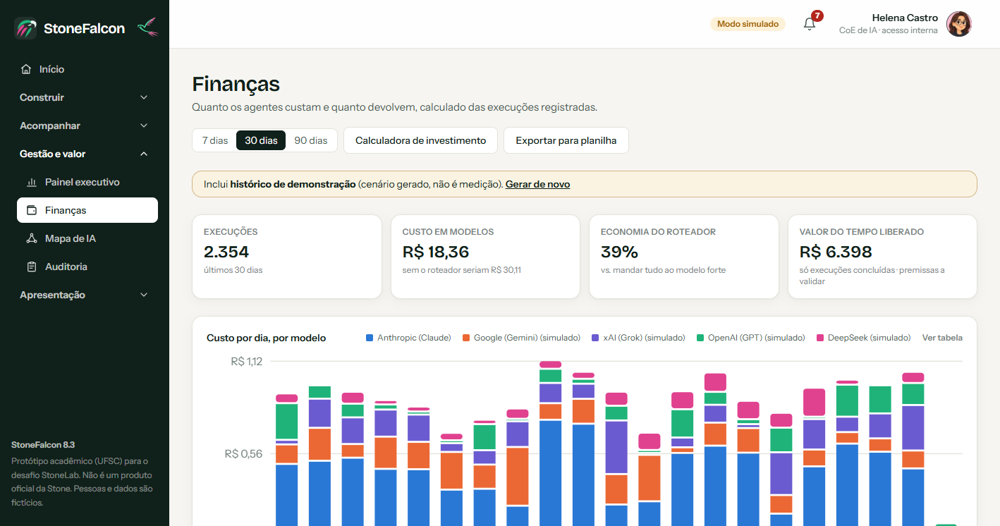</p>

<p align="center">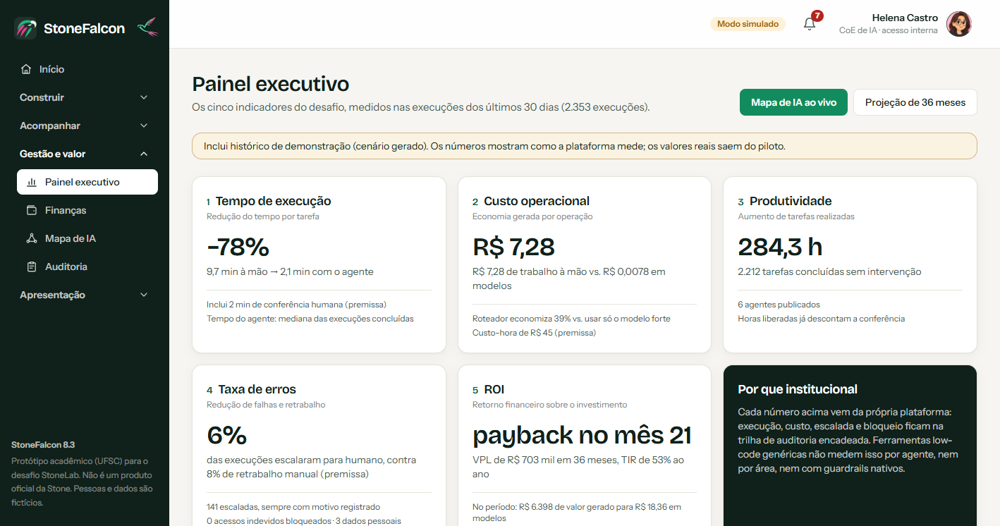</p>

<p align="center">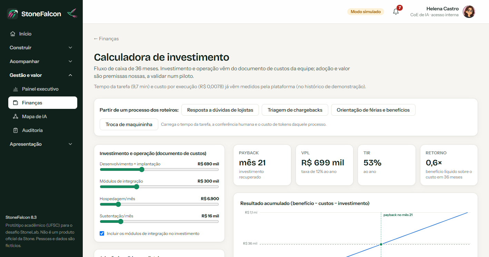</p>

### 9. Integrar plugins e trabalhar com planilhas de verdade

- **Marketplace** com plugins homologados: Arquivos e Planilhas, Zendesk, Salesforce, Slack, Jira, Google Drive, Google Sheets, ServiceNow, SAP SuccessFactors e Datadog. Integrar coloca as ferramentas no catálogo e as transforma em blocos de processo. Plugin confidencial ou restrito passa pela aprovação da Segurança.
- **Arquivos e Planilhas funciona de verdade:** envie um CSV ou Excel, escolha a classificação e as áreas, e agentes e processos listam, leem, acham, acrescentam e atualizam linhas. Escrita em arquivo confidencial espera confirmação humana, e cada escrita registra quem, qual processo e qual linha.
- **Crie o seu plugin:** cole a descrição pública de uma ferramenta de mercado e a plataforma rascunha um plugin interno (ferramentas, riscos e a conta de comprar × construir), que passa pela aprovação da analista de IA.
- **Catálogo de ferramentas** com classificação (pública → restrita), áreas, tipo (leitura ou escrita) e confirmação exigida.

<p align="center">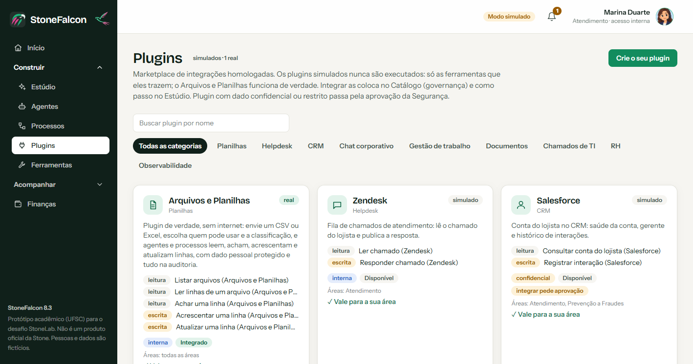</p>

<p align="center">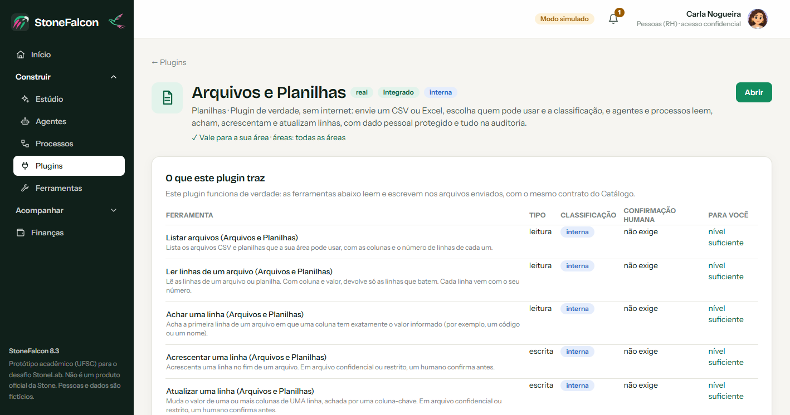</p>

<p align="center">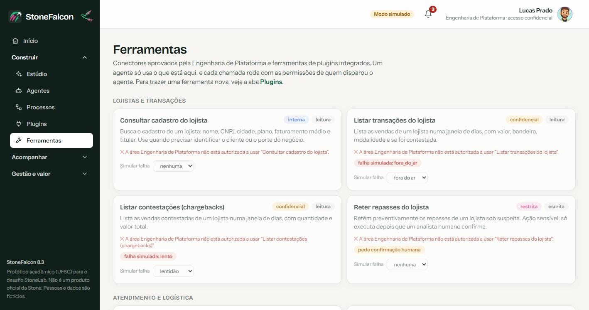</p>

### 10. Ver o Mapa de IA ao vivo

Quem criou → processos → agentes → modelos por provedor → plugins e ferramentas → plataformas da Stone, atualizado a cada poucos segundos, com um pulso por execução, filtros por área e provedor e um relógio da demo para avançar dias e semanas.

<p align="center">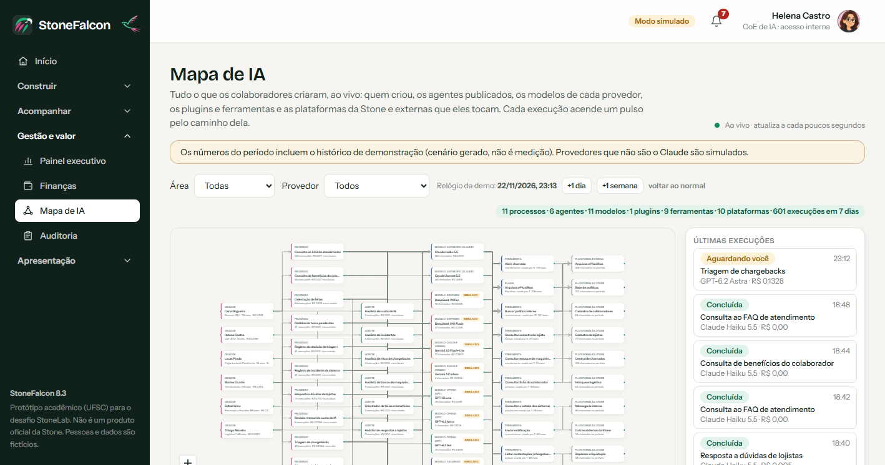</p>

### 11. Usar o copiloto em qualquer página (extensão)

A extensão para Chrome e Edge leva os agentes para onde o trabalho acontece:

- Selecione um texto e clique em **"Perguntar ao StoneFalcon"**, ou use o botão direito → *Responder com: agente*.
- O **painel lateral** sugere o processo pelo trecho, detecta o lojista citado, preenche os campos, executa, pede confirmação de ações sensíveis e guarda o histórico.
- **"Criar Agente de IA com este trecho"** abre o Estúdio já no mesmo perfil.
- A extensão não tem lógica nem chave: tudo roda na plataforma, com as permissões de quem está logado.

Para ensaiar sem instalar, abra `/demo/helpdesk`: um helpdesk fictício que abre o mesmo painel.

<p align="center">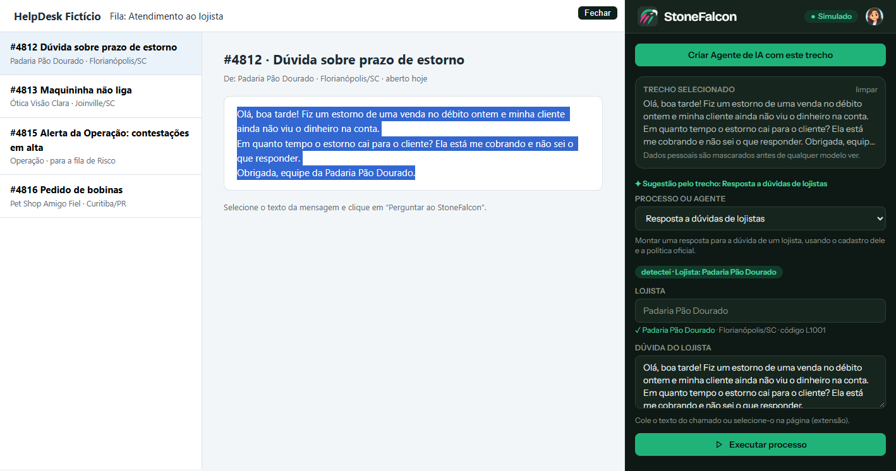</p>

### 12. Apresentar com roteiros guiados

Cada persona tem um **roteiro** com entradas pré-determinadas e sem chave da API: a barra na base mostra o passo, a ação esperada e a fala sugerida, troca de perfil sozinha e reinicia a plataforma no estado exato do início. Cada roteiro termina num cartão **AS IS × TO BE** nos cinco critérios, e cada número diz de onde vem: *medido*, *estimado*, *premissa* ou *hipótese*.

A Helena tem ainda o **roteiro do pitch** (8 a 10 minutos) e as **Perguntas da Ferramenta** (`Alt + B`), com respostas curtas e o botão *Mostrar na tela*. O **falcão companheiro** guia os roteiros, cumprimenta, avisa de alertas e pode ser silenciado.

<p align="center">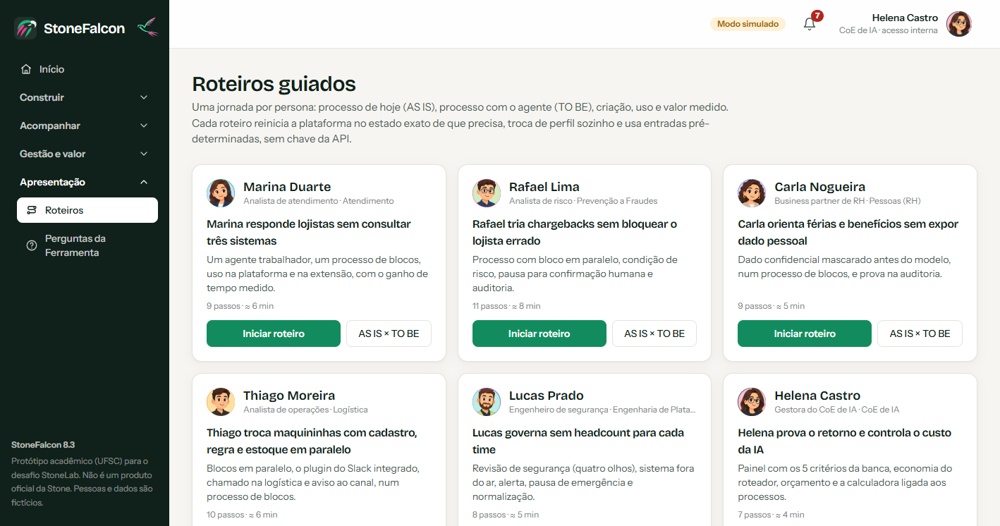</p>

## Quem pode o quê

| Recurso | Quem |
|---|---|
| Criar agentes e processos | Criadores de cada área (Marina, Rafael, Carla, Thiago, Lucas e Helena) |
| Executar | Quem tem a **área e o nível** exigidos pelas ferramentas |
| Revisar risco alto | Segurança (Lucas), nunca quem escreveu a versão |
| Integrar plugin | Criador da área do plugin ou Engenharia; confidencial ou restrito pede aprovação |
| Aprovar "Crie o seu plugin" | Analista de IA (Helena); Segurança (Lucas) quando há dado confidencial |
| Mapa de IA, Painel executivo, Roteiros de todos, Perguntas | Helena (CoE de IA) |
| Auditoria | CoE de IA e Segurança |

O menu e as rotas do front só leem a lista de abas que o back devolve. Endereço digitado sem permissão volta ao Início e a API responde 403.

## Começo rápido

**Pré-requisitos:** Python **3.11+** e, só na primeira vez, **Node.js LTS** (para compilar as telas).

```bash
git clone https://github.com/jpebecker/stoneFalcon.git
cd stoneFalcon
```

- **Windows:** dois cliques em `iniciar.bat`
- **Mac/Linux:** `sh iniciar.sh`

Abre em **http://localhost:8765**. Sem configuração, roda em **modo simulado**: sem chave, sem custo e sem internet. Runtime, guardrails, auditoria, alertas e custos funcionam como no modo real; só o texto dos modelos é de exemplo.

<details>
<summary><strong>Usar modelos reais (Claude)</strong></summary>

1. Crie uma chave em https://platform.claude.com e **defina um limite de gasto mensal**.
2. Copie `backend/.env.exemplo` para `backend/.env` e preencha `ANTHROPIC_API_KEY`.
3. Ligue de novo. O selo no topo muda para **Modelos reais**.

Nunca coloque a chave no código, na extensão ou no Git (`.env` está no `.gitignore`).
</details>

<details>
<summary><strong>Instalar a extensão copiloto</strong></summary>

`chrome://extensions` → **Modo do desenvolvedor** → **Carregar sem compactação** → pasta `extensao`. Na primeira vez abre uma tela de boas-vindas que testa a conexão com a plataforma.
</details>

<details>
<summary><strong>Variáveis opcionais</strong></summary>

| Variável | Efeito |
|---|---|
| `STONEFALCON_PORTA` | Porta do servidor (padrão `8765`) |
| `STONEFALCON_SEM_NAVEGADOR=1` | Não abre o navegador ao ligar |
| `STONEFALCON_SEM_PAUSA=1` | (Windows) não pausa o terminal ao sair |

Os scripts explicam em português o que costuma dar errado: Python abaixo de 3.11, Node.js ausente e porta ocupada.
</details>

## Arquitetura

```
 frontend (React + Vite + Tailwind + React Flow)        extensão (MV3)
                         │  /api/v1                         │
                         ▼                                  ▼
 backend FastAPI ── Estúdio ── Runtime (DAG + loop + roteador) ── Ciclo de vida ── Saúde ── Finanças
        │                │          (agente = trabalhador · processo = fluxo de blocos)
        │          Guardrails ──── Catálogo de ferramentas ── Plugins (simulados + Arquivos e Planilhas, real)
        ▼
 SQLite (protótipo) / Postgres (produção) · trilha de auditoria encadeada por hash
        ▲
 Claude Haiku 5.5 / Sonnet 5.5 (ou simulador); Gemini, GPT, DeepSeek e Grok só simulados
```

| Pasta | Conteúdo |
|---|---|
| `backend/app/studio` | Descrição → blueprint do agente |
| `backend/app/runtime` | Grafo de passos, loop pensar → agir → observar, limites, escalada, aprovação e retomada |
| `backend/app/processos` | Processos de blocos: blueprint, compilação, validação e ciclo de vida |
| `backend/app/llm` | Cliente Claude, simulador, registro de provedores, roteador, balanceador e preços |
| `backend/app/tools` | Catálogo, permissões e executor governado |
| `backend/app/guardrails` | Mascaramento de dados sensíveis e detecção de instrução embutida |
| `backend/app/observability` | Métricas, alertas e tratamento |
| `backend/app/finance` | Premissas, ROI e calculadora |
| `backend/app/plugins` | Marketplace, Arquivos e Planilhas, "Crie o seu plugin" |
| `backend/app/audit` | Trilha encadeada por hash |
| `backend/app/roteiros` | Roteiros por persona, valor medido e perguntas |
| `frontend/src` | Telas em React (uma por arquivo em `pages/`) |
| `extensao/` | Extensão copiloto (Manifest V3) |
| `entregaveis/` | Análise financeira (`.xlsx`), apresentação (`.pptx`) e geradores |

**Stack:** Python · FastAPI · SQLModel · SQLite · Anthropic SDK · openpyxl · React 18 · TypeScript · Vite · Tailwind CSS · React Flow.

## Desenvolvimento e CI

```bash
# back (um processo só, sem --workers)
cd backend && uv sync && uv run uvicorn app.main:app --reload --port 8765

# front (http://localhost:5173, repassa /api ao backend)
cd frontend && npm install && npm run dev

# testes (sem chave nem internet)
cd backend && uv run pytest -q
```

A esteira (`.github/workflows/ci.yml`) roda em todo PR e na `main`:

1. **Back:** `pytest` em Python 3.11 e 3.14, em modo simulado (700+ testes, incluindo os seis roteiros de ponta a ponta pela API).
2. **Front:** checagem de tipos e build de produção.
3. **Extensão:** manifesto válido e arquivos citados existem.
4. **Versão:** extensão, API e front com o mesmo número (fonte: `backend/app/core/versao.py`).
5. **Scripts de início:** `iniciar.sh` (Ubuntu) e `iniciar.bat` (Windows) sobem a plataforma e respondem em `/api/v1/saude`.

## Protótipo × produção

| No protótipo | Em produção |
|---|---|
| Login simulado por personas | SSO da Stone (grupos → papéis e nível de acesso) |
| Sistemas internos fictícios | Conectores reais (APIs internas ou webhooks n8n), mesmo contrato |
| Semelhança por radicais e sinônimos | Embeddings |
| Guardrails por expressões regulares | Serviço de DLP + classificador de injeção |
| SQLite, um processo | Postgres com controle de acesso, retenção e trava no banco |
| Trilha encadeada por hash | O mesmo, com hashes diários publicados num cofre externo (WORM) |
| Alertas no sino da plataforma | Também por e-mail, Slack e plantão |

## Documentação

| Documento | Conteúdo |
|---|---|
| [LEIA-ME.md](LEIA-ME.md) | Guia completo: novidades de cada versão, matrizes de acesso, números e de onde vêm, o que foi testado |
| [docs/REQUIREMENTS.md](docs/REQUIREMENTS.md) | Requisitos do desafio |
| [docs/ARCHITECTURE.md](docs/ARCHITECTURE.md) | Arquitetura em detalhe |
| [docs/DESIGN.md](docs/DESIGN.md) | Linguagem visual e regras do falcão companheiro |
| [docs/ENSAIO-GERAL.md](docs/ENSAIO-GERAL.md) | Roteiro do pitch e checklist |
| [docs/AGENTS.md](docs/AGENTS.md) | Guia de trabalho no repositório |
| [entregaveis/LEIA-ME.md](entregaveis/LEIA-ME.md) | Análise financeira e apresentação |
